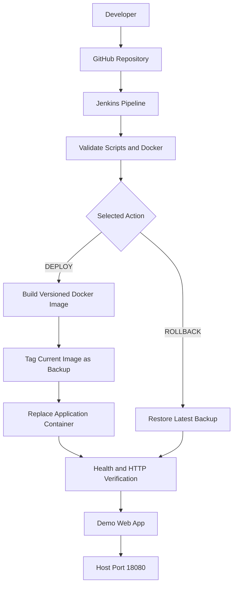

# Jenkins Docker CI/CD Lab

A hands-on DevOps project demonstrating Jenkins-driven Docker image builds, application deployment, health verification, image backups, and rollback.

## Project Objectives

- Build a versioned Docker image from application source.
- Deploy a selected application version through Jenkins.
- Verify container health and the HTTP response after deployment.
- Create timestamped backups of the previously deployed image.
- Roll back to a previous backup through Jenkins.
- Retain a maximum of two timestamped backup images.
- Keep deployment logic in shell scripts and orchestration in a Jenkins Pipeline.

## Architecture



## Repository Structure

```text
jenkins-docker-cicd-lab/
├── Jenkinsfile
├── Dockerfile
├── README.md
├── .gitignore
├── app/
│   └── index.html
├── scripts/
│   ├── deploy.sh
│   └── rollback.sh
├── docs/
│   └── SCREENSHOTS.md
├── screenshots/
└── backups/
```

## Technology Stack

- Jenkins Pipeline
- Docker Engine
- Docker images and containers
- Bash scripting
- Git and GitHub
- Nginx Alpine
- Linux health checks and HTTP verification

## Prerequisites

- A Linux host with Docker Engine installed and running.
- Jenkins with Pipeline support.
- Git installed on the Jenkins host.
- Jenkins permission to use Docker.
- The project checked out into the Jenkins workspace.
- `curl`, Bash, and the `docker` CLI available to Jenkins.

> Docker group membership provides highly privileged access to the host. Use this arrangement only where the security implications are understood.

## Jenkins Parameters

| Parameter | Values | Purpose |
|---|---|---|
| `ACTION` | `DEPLOY`, `ROLLBACK` | Select deployment or rollback |
| `APP_VERSION` | For example, `1.3` | Image version used for deployment |

The current lab publishes the application on host port `18080`.

## Deployment Flow

1. Jenkins checks out the repository.
2. The Pipeline validates the scripts and Docker access.
3. The deployment script builds a versioned image.
4. The current image is tagged as a timestamped backup.
5. The application container is recreated using the requested image.
6. The script waits for container health and checks the HTTP response.
7. Older timestamped backup tags are pruned to retain at most two.

## Rollback Flow

1. Jenkins runs the rollback script.
2. The script selects the newest timestamped backup by tag.
3. The container is recreated using that image.
4. The script checks container health and the HTTP response.

Rollback selects the latest available backup; it does not necessarily select the immediately preceding deployment if multiple deployments or rollbacks have occurred.

## Local Verification

Inspect the running container:

```bash
sudo docker ps --filter name=cicd-demo-app
sudo docker inspect cicd-demo-app \
  --format 'Status={{.State.Status}} Health={{.State.Health.Status}}'
```

Check the application response:

```bash
curl --fail --silent --show-error http://127.0.0.1:18080/ \
  | grep -E 'Version:|Status: Running'
```

List application images and backups:

```bash
sudo docker image ls cicd-demo-app
```

## Repository Setup

1. Push this project to your GitHub repository.
2. In Jenkins, configure the job as **Pipeline script from SCM**.
3. Select **Git** as the SCM.
4. Enter the GitHub repository URL and configure credentials if the repository is private.
5. Set the branch to the intended branch, such as `*/main`.
6. Set the Script Path to `Jenkinsfile`.
7. Save and run the job with `ACTION=DEPLOY`.

The Jenkinsfile and scripts in this repository are the source of truth for the workflow. Validate the actual build and rollback results before presenting the project as production-ready.

## Troubleshooting

### Jenkins cannot access Docker

Check that Jenkins has the intended Docker permissions and that the Docker service is running:

```bash
sudo systemctl status docker --no-pager
id jenkins
sudo -u jenkins docker info
```

### Deployment fails its health check

Inspect the container and logs:

```bash
sudo docker ps -a --filter name=cicd-demo-app
sudo docker logs cicd-demo-app
sudo docker inspect cicd-demo-app
```

### Application is not reachable

```bash
curl -v http://127.0.0.1:18080/
sudo docker port cicd-demo-app
```

Check port conflicts and host firewall rules if needed.

## Screenshots

See [`docs/SCREENSHOTS.md`](docs/SCREENSHOTS.md) for the portfolio capture checklist.

## Security Notes

- Never commit passwords, tokens, private keys, `.env` files, or Jenkins secrets.
- Use Jenkins credentials for private repository access.
- Use sanitized screenshots and generic lab names in a public portfolio.
- This is a learning lab. Review deployment and rollback behavior before adapting it to production.
